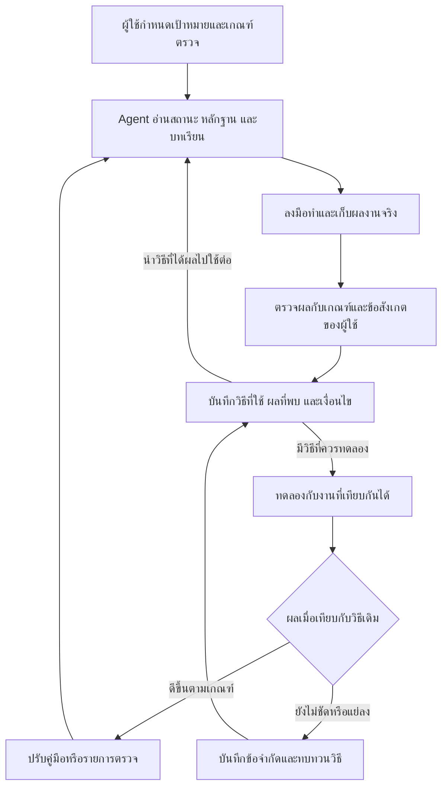

# Advisor

Advisor เป็นคู่มือออกแบบวิธีทำงานร่วมกับผู้ช่วยปัญญาประดิษฐ์ หรือ **Agent** ซึ่งเป็นโปรแกรมที่อ่านเอกสารและใช้เครื่องมือทำงานตามเป้าหมายที่ผู้ใช้กำหนด โครงการนี้มีวัตถุประสงค์เพื่อให้ **ประสบการณ์จากงานครั้งก่อนช่วยปรับปรุงวิธีที่ Agent ทำงานให้เราในครั้งถัดไป** ใช้ได้กับการเรียน การวิจัย และงานที่มีผู้รับผิดชอบหลายคน

ตัวอย่างสมมติ ผู้เรียนพบว่าตนคำนวณค่าเฉลี่ยถ่วงน้ำหนักได้ แต่ยังเลือกน้ำหนักผิดเมื่อกลุ่มตัวอย่างมีขนาดต่างกัน หาก Agent บันทึกเพียงว่า “อ่านบทนี้จบแล้ว” ครั้งถัดไปก็มีข้อมูลเพียงว่าผู้เรียนอ่านถึงไหน หากบันทึกโจทย์ที่ทำผิดและเหตุผลไว้ด้วย Agent จะนำจุดที่ต้องฝึกมาเลือกโจทย์ใหม่ แล้วตรวจว่าผู้เรียนอธิบายการเลือกน้ำหนักได้ด้วยตนเองหรือยัง

## ให้ Agent เริ่มทำงานในเครื่องของคุณ

ใช้ผู้ช่วย AI ที่มีสิทธิ์อ่านและเขียนไฟล์ในโฟลเดอร์ที่คุณเลือก ดาวน์โหลดไฟล์ `AGENTS.md` หรือคัดลอกเนื้อหาทั้งหมดลงในไฟล์ชื่อนี้ แล้ววางไว้ในโฟลเดอร์ส่วนตัวของงาน หากงานเดิมมีไฟล์ชื่อนี้อยู่แล้ว ให้วางคู่มือฉบับนี้ไว้ในโฟลเดอร์ย่อย `advisor/` และบอกตำแหน่งทั้งสองไฟล์แก่ผู้ช่วย [เปิดไฟล์ AGENTS.md สำหรับนำไปใช้](AGENTS.md)

คัดลอกข้อความด้านล่างไปให้ผู้ช่วย แล้วแทนข้อความในวงเล็บเหลี่ยมด้วยงานของคุณ หากวางคู่มือไว้ในโฟลเดอร์ย่อย ให้ระบุ `advisor/AGENTS.md` ในข้อความด้วย

> อ่าน AGENTS.md ของ Advisor และข้อตกลงเดิมในโฟลเดอร์นี้ แล้วใช้วิธีดังกล่าวช่วยฉันทำงานเรื่อง [ระบุงาน] ผลที่ต้องการคือ [ระบุผลงานหรือเป้าหมาย] ตรวจว่ามีบันทึกสถานะเดิมหรือยัง จัดเตรียมส่วนที่ขาด แล้วเริ่มทำงานขั้นแรกที่ทำได้จากข้อมูลที่มี เมื่อจบให้บันทึกผล หลักฐาน และสิ่งที่จะใช้หรือปรับครั้งหน้า

เมื่อใช้ครั้งแรก คุณจะได้บันทึกสถานะในเครื่องที่ระบุเป้าหมาย สิ่งที่ยืนยันได้ และงานถัดไป หากมีเอกสารต้นฉบับพร้อมแล้ว Agent จะใช้เอกสารเหล่านั้นทำงานขั้นแรกได้เลย คู่มือมีแบบบันทึกย่ออยู่ภายใน จึงใช้ได้ทั้งแบบคัดลอกไฟล์เดียวและแบบดาวน์โหลดทั้งคลัง

## สถาปัตยกรรมที่ทำให้ Agent เรียนรู้จากงานที่ผ่านมา

สถาปัตยกรรมในที่นี้หมายถึงการออกแบบให้ **ผู้ใช้ ผู้ช่วย AI และแฟ้มความรู้** ทำงานสัมพันธ์กัน ผู้ใช้กำหนดผลที่ต้องการและเกณฑ์คุณภาพ Agent อ่านสถานะปัจจุบัน หลักฐาน และบทเรียนที่เกี่ยวข้องก่อนลงมือทำ ส่วนแฟ้มความรู้เก็บทั้งผลจริงและวิธีทำงานที่ทดสอบแล้ว เมื่อเปลี่ยนผู้ช่วย ผู้รับช่วงจึงใช้ประสบการณ์ชุดเดิมได้

กลไกสำคัญคือ **วงจรป้อนกลับเพื่อปรับปรุงการทำงานอย่างต่อเนื่อง (feedback loop)** เมื่อจบงาน Agent เปรียบเทียบผลกับเกณฑ์และข้อทักท้วงของผู้ใช้ บันทึกว่าวิธีใดได้ผลภายใต้เงื่อนไขใด แล้วทดลองสิ่งที่ควรปรับกับงานที่เทียบกันได้ ผลที่ดีขึ้นตามเกณฑ์จึงนำไปปรับคู่มือหรือรายการตรวจสำหรับงานรอบถัดไป สิ่งที่พัฒนาขึ้นคือความรู้และวิธีปฏิบัติที่ Agent เปิดใช้ได้ แม้ทำงานด้วยโมเดลรุ่นเดิม

ตัวอย่างในงานวิจัย หาก Agent สรุปตัวเลขได้ถูกต้องแต่ผู้ตรวจต้องสอบถามที่มาของตัวเลขหลายครั้ง อาจทดลองให้ Agent ระบุชื่อชีตและช่องข้อมูลกำกับทุกยอด นำรายงานจากทั้งสองวิธีมาตรวจด้วยเกณฑ์เดียวกันว่า **ตามยอดกลับไปยังต้นทางได้กี่รายการ และยอดยังถูกต้องหรือไม่** หากวิธีใหม่ช่วยให้ตรวจย้อนกลับได้มากขึ้นและยอดถูกต้อง จึงเพิ่มขั้นตอนนี้ในรายการตรวจรายงานประเภทเดียวกัน [แนวคิดที่นำมาประยุกต์และแหล่งอ่านเพิ่มเติม](docs/tools.md)

## ประโยชน์ของการเก็บความรู้ไว้กับงาน

แฟ้มความรู้ทำหน้าที่เป็น **สมองที่สอง (Second Brain)** ของโครงการ หมายถึงแหล่งเก็บความรู้ภายนอกความจำของบุคคลที่ผู้อื่นค้น ตรวจสอบ และนำมาใช้ต่อได้

| สถานการณ์ | สิ่งที่บันทึกไว้ | ประโยชน์ที่ได้รับ |
|---|---|---|
| กลับมาทำงานหลังเว้นช่วง | สิ่งที่เสร็จ ประเด็นที่ค้าง และงานถัดไป | เริ่มทำต่อจากจุดที่ค้างไว้ได้ |
| ต้องอธิบายข้อสรุปในรายงาน | ชื่อเอกสาร ฉบับ และหน้าหรือช่องในตารางที่ใช้ | ผู้อ่านตรวจตัวเลขหรือข้อความกับต้นทางได้ |
| เปลี่ยนผู้รับผิดชอบหรือผู้ช่วย AI | ผลงานล่าสุด เหตุผลที่ตัดสินใจ และเรื่องที่รอคำตอบ | ผู้รับช่วงเห็นว่างานใดทำต่อได้และเรื่องใดต้องรอ |
| ทำงานลักษณะเดิมอีกครั้ง | ขั้นตอนที่ใช้ได้ ปัญหาที่เคยพบ และวิธีตรวจ | นำวิธีเดิมมาปรับใช้และตรวจจุดที่เคยพลาดได้ |

ผู้ที่เพิ่งเริ่มต้นสามารถใช้วิธีนี้ด้วยโปรแกรมจดข้อความทั่วไป เมื่อมีผู้ช่วย AI ให้ผู้ช่วยเปิดบันทึกชุดเดียวกันก่อนเริ่มงานแต่ละครั้ง

## ตัวอย่างการเริ่มบันทึกด้วยตนเอง

๑. **เลือกงานหนึ่งเรื่อง** ระบุสิ่งที่ต้องการทำให้เสร็จและวิธีตรวจ เช่น “ทบทวนเรื่องค่าเฉลี่ยถ่วงน้ำหนัก จนเลือกสูตรและอธิบายเหตุผลได้ด้วยตนเอง”

๒. **เตรียมบันทึกหนึ่งหน้า** คัดลอกแบบบันทึกสถานะไปไว้ในโฟลเดอร์ส่วนตัวของงาน กรอกสิ่งที่ทำแล้ว หลักฐานที่เปิดดูได้ และสิ่งที่จะทำต่อ ช่องที่ยังไม่ทราบให้ระบุว่ารอยืนยัน [เปิดแบบบันทึกสถานะ](starter/current_state.md)

๓. **ตรวจผลและนำบทเรียนไปใช้** เมื่อทำงานเสร็จ ให้จดสั้น ๆ ว่าใช้วิธีใด ได้ผลอย่างไร และคราวหน้าจะลองปรับอะไร ครั้งถัดไปให้ Agent อ่านบันทึกนี้ก่อนเริ่ม แล้วตรวจผลด้วยเกณฑ์เดิม

## ไฟล์และโฟลเดอร์ที่เปิดอ่านได้บน GitHub

| ตำแหน่ง | ใช้เมื่อใด |
|---|---|
| `README.md` | หน้าที่กำลังอ่าน ใช้ทำความเข้าใจวัตถุประสงค์และเลือกวิธีเริ่มต้น |
| `AGENTS.md` | คำสั่งสำหรับให้ผู้ช่วยเริ่มทำงานในเครื่อง มีแบบบันทึกย่อและวิธีเรียนรู้จากผลของงานแต่ละรอบ [เปิดข้อตกลง](AGENTS.md) |
| `docs/` | เมื่ออยากเห็นตัวอย่างการเรียน การวิจัย หรืองานทีม หรือเลือกโปรแกรมให้เหมาะกับงาน [วิธีทำงานและตัวอย่าง](docs/working-method.md) · [โปรแกรมและโครงการ GitHub ที่ใช้](docs/tools.md) |
| `starter/` | เมื่อต้องการเริ่มบันทึกงานของตนเอง มีแบบเปล่าให้คัดลอกไปกรอกในพื้นที่ส่วนตัว [เปิดแบบบันทึกสถานะ](starter/current_state.md) |

ไฟล์นามสกุล `.md` เป็นไฟล์ข้อความที่เปิดอ่านได้บน GitHub หรือด้วยโปรแกรมจดข้อความ หากต้องการเก็บคู่มือทั้งชุดไว้บนเครื่อง ให้เลือก **Code → Download ZIP** ที่หน้าแรกของคลัง แล้วแตกไฟล์ในพื้นที่ส่วนตัว

## วิธีจัดโฟลเดอร์ในงานของตนเอง

ตารางนี้เป็นโครงสร้างตัวอย่างสำหรับสร้างบนเครื่องของผู้ใช้ เริ่มจาก `00_inbox/` สำหรับต้นฉบับ และ `01_current/` สำหรับสถานะปัจจุบัน เมื่อมีผลงานพร้อมใช้จึงเพิ่ม `09_outputs/` ส่วนโฟลเดอร์ที่เหลือเลือกใช้ตามลักษณะงาน ตัวเลขหน้าชื่อช่วยเรียงโฟลเดอร์ให้หาได้ง่าย

| โฟลเดอร์ | เก็บอะไร | ตัวอย่างสมมติจากงานวิจัยหนึ่งเรื่อง |
|---|---|---|
| `00_inbox/` | หลักฐานต้นฉบับที่ได้รับ เก็บฉบับเดิมไว้สำหรับตรวจย้อนกลับ | ข้อมูลการทดลองชุดแรกที่ได้รับจากผู้เก็บข้อมูล |
| `01_current/` | สถานะล่าสุด งานถัดไป และเรื่องที่รอยืนยัน | บันทึกว่าได้ตรวจข้อมูลชุดใดแล้ว และชุดใดยังรอคำอธิบายหน่วยวัด |
| `02_knowledge/` | ความรู้ที่ตรวจแล้วและใช้ข้ามงานได้ | คำอธิบายหน่วยวัดพร้อมแหล่งอ้างอิง |
| `03_history/` | ลำดับเหตุการณ์และเหตุผลของการตัดสินใจที่ผ่านมา | บันทึกว่าเปลี่ยนวิธีสุ่มตัวอย่างเมื่อใดและเพราะเหตุใด |
| `04_procedures/` | ขั้นตอนปฏิบัติและรายการตรวจสำหรับงานที่ทำซ้ำ | วิธีตรวจหน่วยวัดและรายการข้อมูลซ้ำก่อนวิเคราะห์ |
| `05_templates/` | แบบเปล่าที่คัดลอกไปใช้ได้ | ตารางเปล่าสำหรับบันทึกการทดลอง |
| `06_lessons/` | สิ่งที่เรียนรู้จากการลงมือทำและข้อปรับปรุงสำหรับรอบหน้า | ข้อค้นพบว่าการระบุหน่วยวัดตั้งแต่วันเก็บข้อมูลช่วยลดการสอบถามย้อนหลัง |
| `07_projects/` | แผนและชิ้นงานระหว่างทำของงานย่อยที่มีเป้าหมายเฉพาะ | แผนการทดลองนำร่องและร่างผลวิเคราะห์ |
| `08_index/` | สารบัญที่ชี้ไปยังไฟล์หรือหัวข้อที่ต้องการค้น | รายการชุดข้อมูลพร้อมลิงก์ไปยังต้นฉบับและรายงานที่ใช้ข้อมูลชุดนั้น |
| `09_outputs/` | ผลงานที่ตรวจแล้วและพร้อมนำไปใช้หรือส่งมอบ | รายงานผลการศึกษาและตารางผลฉบับส่งมอบ |
| `archive/` | เอกสารฉบับเก่าและชุดงานที่ปิดแล้ว สำหรับเปิดอ้างอิงย้อนหลัง | แบบเก็บข้อมูลฉบับก่อนปรับปรุง |

หากใช้ **Obsidian** เป็นสมุดความรู้ อาจเพิ่ม `raw/` สำหรับข้อความที่ถอดหรือแปลงจากเอกสาร และ `wiki/` สำหรับบันทึกที่เรียบเรียงโดยเชื่อมกลับไปยังหลักฐาน เมื่องานมีการประมวลผลข้อมูล อาจเพิ่ม `scripts/` สำหรับคำสั่งที่ใช้ซ้ำ `data/` สำหรับข้อมูลที่ระบบสร้าง เช่น ดัชนีค้นเอกสาร และ `scratch/` สำหรับไฟล์ทดลองชั่วคราว

## โปรแกรมที่ใช้ร่วมกัน

เราใช้ **Obsidian** เชื่อมบันทึกความรู้ ใช้ **Codex และ Antigravity** ช่วยอ่านและจัดทำงานจากไฟล์ ใช้โปรแกรมเอกสารตรวจต้นฉบับ และเลือกเครื่องมือเสริมตามลักษณะงาน เช่น แปลงเอกสารให้อ่านค้นได้ หรืออ่านข้อความจากภาพสแกน เอกสารที่เผยแพร่ในคลังนี้เป็นคู่มือ ตัวอย่างสมมติ และแบบเปล่า ส่วนหลักฐานและบันทึกที่กรอกแล้วให้เก็บในพื้นที่ส่วนตัวของแต่ละโครงการ [บทบาทของโปรแกรมและแหล่งโครงการต้นทาง](docs/tools.md)
