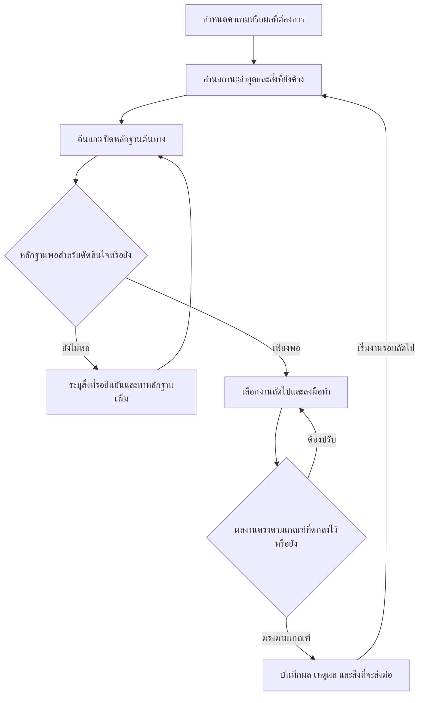

# Advisor

Advisor เป็นแนวทางจัดแฟ้มโครงการให้คนและผู้ช่วย AI ทำงานต่อกันได้ แม้จะเว้นช่วงไปหลายสัปดาห์หรือเปลี่ยนผู้รับผิดชอบ เมื่อกลับมาเปิดแฟ้ม ผู้รับช่วงควรตอบได้สามคำถามว่า งานคืบหน้าไปถึงไหน ข้อสรุปที่ผ่านมาอาศัยหลักฐานใด และงานถัดไปควรเริ่มตรงไหน

พื้นที่นี้ทำหน้าที่เป็นสมองที่สอง (Second Brain) ของโครงการ ผู้ใช้กำหนดเป้าหมายและตัดสินใจ ส่วนผู้ช่วยค้นหลักฐาน เสนอทางเลือก และบันทึกผลที่ตรวจแล้ว

แนวคิดนี้ใช้ได้กับการเรียนด้วยตนเอง การวิจัย และการทำงานเป็นทีม ส่วนที่แต่ละโครงการกำหนดเองคือเป้าหมาย ลักษณะของหลักฐาน และเกณฑ์ที่ใช้ตัดสินว่างานเสร็จแล้ว

## หลักคิดในการออกแบบ

- **ให้ความรู้คงอยู่กับโครงการ** เก็บสถานะ เหตุผลที่ตัดสินใจ และสิ่งที่ต้องทำต่อไว้ในไฟล์ข้อความแบบ Markdown (`.md`) ซึ่งเปิดอ่านด้วยโปรแกรมทั่วไปได้ ผู้ช่วยคนถัดไปจึงรับงานจากบันทึกชุดเดียวกันได้ แม้จะใช้คนละเครื่องมือ
- **ให้ผู้อื่นตรวจที่มาของข้อสรุปได้** หากรายงานตัวเลข ให้ระบุหน่วยนับ ฉบับของไฟล์ และหน้าหรือช่องที่นำมาใช้ หากคำนวณต่อ ให้บอกวิธีคำนวณสั้น ๆ ด้วย
- **เก็บทั้งสถานะปัจจุบันและประวัติที่ทำให้เข้าใจสถานะนั้น** เมื่อมีหลักฐานใหม่ ให้แก้สถานะปัจจุบันและบันทึกว่าเปลี่ยนเพราะอะไร การแยกวันที่เกิดเหตุออกจากวันที่ได้รับข้อมูลช่วยให้ตอบคำถามย้อนหลังได้ตรงกับสิ่งที่ทราบในเวลานั้น
- **ให้วิธีทำงานเติบโตตามความจำเป็น** งานครั้งแรกอาจใช้เพียงบันทึกสั้น ๆ เมื่อพบว่าต้องตรวจเรื่องเดิมหลายครั้ง จึงเขียนเป็นรายการตรวจหรือแบบฟอร์มให้รอบถัดไปใช้ได้

## วงจรการทำงาน



หากหลักฐานยังขาด ผู้รับช่วงควรเห็นทันทีว่าขาดอะไรและจะหาได้จากที่ใด เมื่อมีข้อมูลเพิ่มจึงกลับมาตัดสินใจต่อได้ ส่วนงานที่ลงมือทำแล้วจะปิดได้เมื่อมีผลงานตรงตามเกณฑ์ที่ตกลงกัน

## โครงสร้างของพื้นที่ทำงาน

ผังนี้เป็นตัวอย่างสำหรับจัดแฟ้มของตนเอง เริ่มจากส่วนที่ใช้งานจริง แล้วค่อยเพิ่มหมวดเมื่อมีงานมากขึ้น

```text
workspace/
├── AGENTS.md                     ข้อตกลงสำหรับผู้ช่วยที่รับช่วงงาน
├── 00_inbox/                     ต้นฉบับที่ได้รับ
├── 01_current/
│   └── current_state.md          สถานะล่าสุด สิ่งที่รอ และงานถัดไป
├── 02_knowledge/                 ความรู้ที่ตรวจแล้วและนำไปใช้กับงานอื่นได้
├── 03_history/                   เหตุการณ์ การตัดสินใจ และกรณีที่ผ่านมา
├── 04_procedures/                ขั้นตอนปฏิบัติและรายการตรวจ
├── 05_templates/                 แบบเปล่าสำหรับงานที่ทำซ้ำ
├── 06_lessons/                   บทเรียนและสิ่งที่ควรปรับในรอบหน้า
├── 07_projects/                  งานย่อยที่มีเป้าหมายและขอบเขตของตนเอง
├── 08_index/                     ดัชนีค้นหัวข้อและตำแหน่งต้นฉบับ
├── 09_outputs/                   ผลงานที่พร้อมนำไปใช้
└── archive/                      ฉบับเก่าและงานที่ปิดแล้ว
```

## โปรแกรมที่ใช้ร่วมกัน

เราใช้ **Obsidian** เป็นสมุดความรู้สำหรับอ่านและเชื่อมบันทึก ใช้ **Codex หรือ Antigravity** ช่วยค้นหลักฐานและทำงานต่อจากสถานะที่บันทึกไว้ ส่วนตัวเลขและข้อความที่นำไปอ้าง เราเปิดตรวจในไฟล์ต้นทางอีกครั้ง เมื่อแฟ้มใหญ่ขึ้นจึงเพิ่มเครื่องมือค้นหรืออ่านภาพสแกนตามความจำเป็น [บทบาทของแต่ละโปรแกรมและตัวอย่างการใช้ Obsidian](docs/tools.md)

## เริ่มใช้กับงานหนึ่งเรื่อง

๑. ดาวน์โหลดชุดเอกสารนี้เป็น ZIP แล้วแตกไฟล์ไว้ในโฟลเดอร์ส่วนตัวสำหรับงานนั้น อ่านข้อตกลงสำหรับผู้ช่วยที่รากของโครงการ แล้วคัดลอกแบบบันทึกเปล่าไปไว้ที่ `01_current/current_state.md` [ข้อตกลงสำหรับผู้ช่วย](AGENTS.md) · [แบบบันทึกสถานะ](starter/current_state.md)

๒. เลือกคำถามที่ต้องตัดสินใจจริง เช่น “ก่อนเริ่มบทต่อไป ยังมีเรื่องใดที่ต้องทบทวน” เขียนผลที่ต้องการกับเกณฑ์ว่างานเสร็จเมื่อใด แล้ววางเอกสารที่จำเป็นไว้ใน `00_inbox/`

๓. ให้ผู้ช่วยอ่านบันทึกและเอกสาร แล้วเสนอสิ่งที่ควรทำต่อพร้อมเหตุผล หลังทำงานให้ระบุว่าได้ผลงานอะไร เก็บไว้ที่ใด และครั้งหน้าควรเริ่มจากจุดไหน

เอกสารในคลังสาธารณะนี้เป็นคู่มือและแบบเปล่า ตัวอย่างเขียนขึ้นเพื่ออธิบายวิธีใช้ ส่วนเอกสารจริงและบันทึกที่กรอกแล้วให้เก็บในพื้นที่ส่วนตัวของแต่ละโครงการ [เทคนิคและตัวอย่างการปรับใช้](docs/working-method.md)
